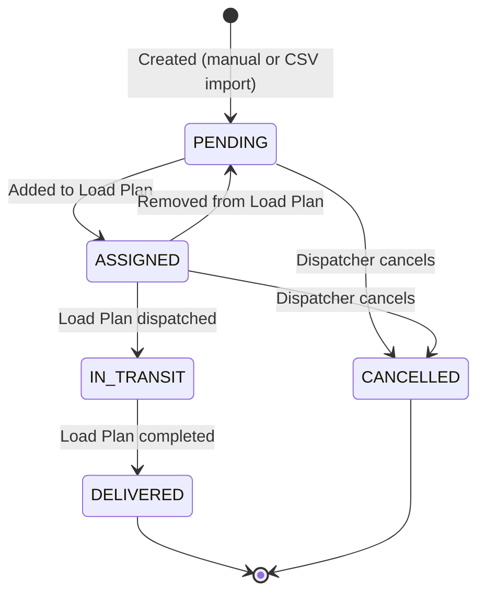
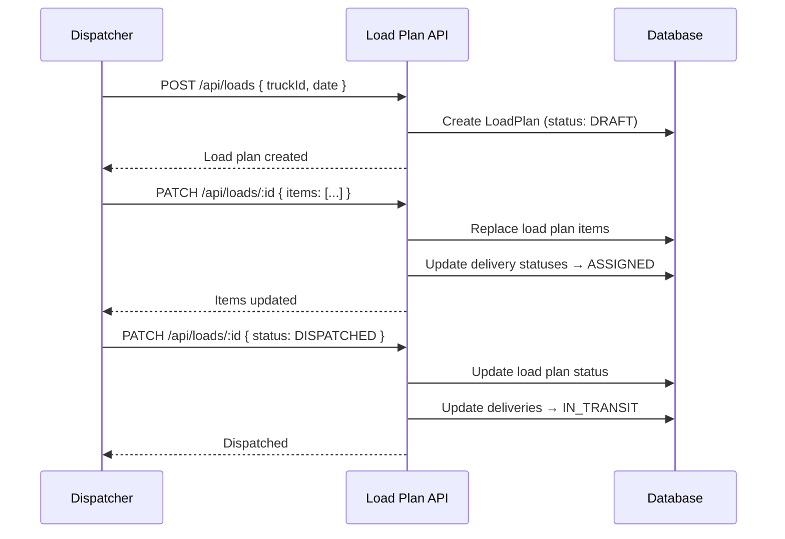
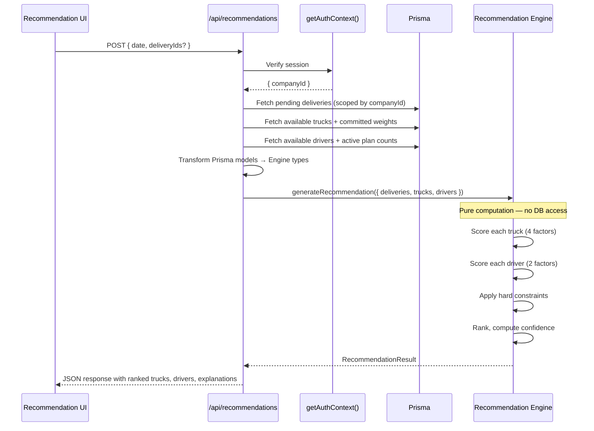
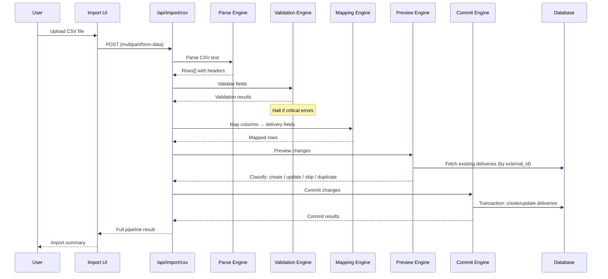
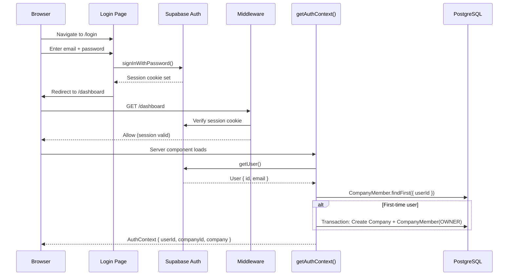
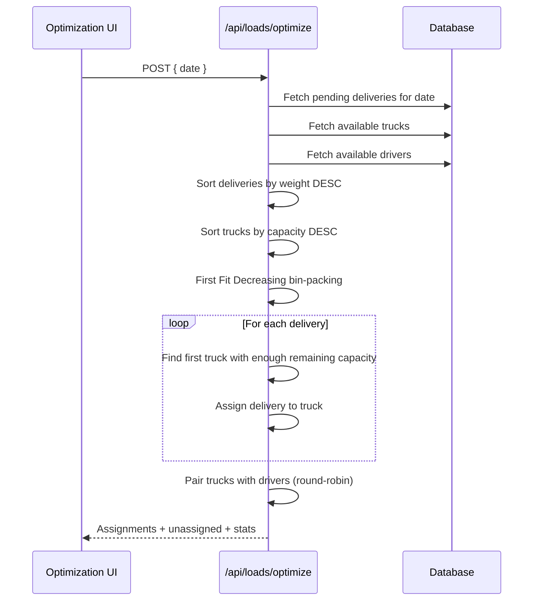

# System Workflows

## Delivery Lifecycle



### Key Rules
- `PENDING → ASSIGNED`: Automatic when delivery is added to a load plan in `DRAFT` status via `POST /api/loads`, `PATCH /api/loads/:id`, or `POST /api/recommendations/assign`.
- `ASSIGNED → PENDING`: Automatic safe release when delivery is removed from a plan or plan is deleted. Deliveries in terminal or non-assigned statuses (e.g. `CANCELLED`, `DELIVERED`, `IN_TRANSIT`) are never reverted to `PENDING`.
- `IN_TRANSIT → DELIVERED`: Only via load plan completion (`PATCH /api/loads/:id` with `status: COMPLETED`).
- Direct status changes are limited to cancellation only. All other transitions go through the load plan workflow.
- Core fields cannot be edited once status is `IN_TRANSIT` or `DELIVERED`.

---

## Load Plan Lifecycle

```mermaid
stateDiagram-v2
    [*] --> DRAFT: Created (unlocked)

    DRAFT --> READY: Finalize details (locked)
    READY --> DRAFT: Revert to unlock for editing
    READY --> DISPATCHED: Dispatch execution starts
    DISPATCHED --> COMPLETED: Execution finished (terminal)

    note right of DRAFT: Editable: items, truck, driver can change freely
    note right of READY: Locked: content cannot change; revert to DRAFT to edit
    note right of DISPATCHED: Deliveries → IN_TRANSIT, Truck → IN_USE, Driver → ON_TRIP
    note right of COMPLETED: Terminal state: Deliveries → DELIVERED, Truck & Driver → AVAILABLE
```

### Plan Editing & Deletion Rules

- **Editable Status:** A load plan can **ONLY** be modified (items, truck, driver) while in `DRAFT` status. Plans in `READY`, `DISPATCHED`, or `COMPLETED` reject item/resource edits with `400 Bad Request`.
- **Reverting to Edit:** If a finalized `READY` plan needs changes, dispatchers can transition `READY → DRAFT`. This re-opens the plan for modifications.
- **Deletable Statuses:** A load plan may only be deleted when in `DRAFT` or `READY` status. Plans that have started execution (`DISPATCHED` or `COMPLETED`) cannot be deleted (`400 Bad Request`).
- **Safe Delivery Release:** When a plan is deleted or items are removed, only deliveries in `ASSIGNED` status are returned to `PENDING`. Any `CANCELLED` or other terminal deliveries remain untouched.

### Dispatch Preconditions (`READY → DISPATCHED`)

All preconditions are verified atomically within a database transaction:
1. **Plan Status:** Current plan status must be strictly `READY`. Attempting to dispatch from `DRAFT` is rejected with `409 Conflict`.
2. **Truck Readiness:** Truck must be assigned, non-archived, and not in `MAINTENANCE` status.
3. **Driver Readiness:** Driver must be assigned, non-archived, and not in `OFF_DUTY` status.
4. **Dispatchable Deliveries:** Plan must have at least 1 dispatchable delivery item (in `ASSIGNED` status). CANCELLED items in the plan are skipped.

### Side Effects by Status Transition

| Transition | Side Effects | Guard / Conditions |
|------------|--------------|-------------------|
| `[*] → DRAFT` | Deliveries → `ASSIGNED` | Company-scoped, pending deliveries only, capacity & conflict checks |
| `DRAFT → READY` | Plan locked from content edits | Valid transition |
| `READY → DRAFT` | Plan unlocked for editing | Valid transition |
| `READY → DISPATCHED` | Deliveries → `IN_TRANSIT`, Truck → `IN_USE`, Driver → `ON_TRIP` | Preconditions: active truck (not maint), active driver (not off-duty), >=1 delivery |
| `DISPATCHED → COMPLETED` | Deliveries → `DELIVERED`, Truck → `AVAILABLE`, Driver → `AVAILABLE` | Plan must be currently `DISPATCHED` |
| `DRAFT / READY` deleted | All `ASSIGNED` deliveries → `PENDING` | Plan deleted, `CANCELLED` deliveries left untouched |

---

## Truck Assignment Flow



---

## Recommendation Flow



### Scoring Factors

**Truck Scoring (70% of confidence):**
| Factor | Weight | Algorithm |
|--------|--------|-----------|
| Capacity Fit | 30% | Bell curve peaking at 80% utilization |
| Remaining Capacity | 15% | Normalized: `remainingCapacity / maxCapacity` |
| Availability | 15% | `AVAILABLE` = 1.0, `IN_USE` = 0.5, `MAINTENANCE` = excluded |
| Workload | 10% | Inverse: fewer active plans = higher score |

**Driver Scoring (30% of confidence):**
| Factor | Weight | Algorithm |
|--------|--------|-----------|
| Availability | 20% | `AVAILABLE` = 1.0, `ON_TRIP` = 0.4, `OFF_DUTY` = excluded |
| Workload | 10% | Inverse: fewer active plans = higher score |

---

## CSV Import Flow



### Import Pipeline Stages

1. **Parse** — Converts raw CSV text into structured row objects. Handles quoting, escaping, and header detection.
2. **Validate** — Checks required fields (`customerName`, `deliveryAddress`), data types, and value formats.
3. **Map** — Maps CSV column headers to delivery domain fields using fuzzy matching.
4. **Preview** — Compares mapped data against existing database records. Classifies each row as `create`, `update`, `no_change`, `skip`, or `duplicate`. Computes field-level diffs for updates.
5. **Commit** — Writes changes to the database inside a transaction. Supports rollback on failure. Creates `ImportRow` records for audit trail.

---

## Authentication Flow



### Auto-Provisioning

When a user signs up and accesses the dashboard for the first time:
1. `getAuthContext()` looks up `CompanyMember` by `userId`.
2. If no membership exists, it creates a new `Company` named `"{email prefix}'s Company"`.
3. It creates a `CompanyMember` with role `OWNER` in a single transaction.
4. The user immediately has a fully functional tenant with no manual setup.

---

## Route Optimization Flow



The optimizer uses the **First Fit Decreasing** algorithm: deliveries are sorted heaviest-first, and each is assigned to the first truck that has enough remaining capacity. This produces good utilization without exponential computation.

---

## Recommendation-to-Load-Plan Assignment Flow

`mermaid
sequenceDiagram
    participant D as Dispatcher
    participant UI as Recommendation UI
    participant RE as POST /api/recommendations
    participant AS as POST /api/recommendations/assign
    participant DB as Database

    D->>UI: Select target date
    D->>UI: Click "Generate Recommendation"
    UI->>RE: POST { date }
    RE->>DB: Fetch pending deliveries, trucks, drivers
    RE->>RE: Score & rank (deterministic engine)
    RE-->>UI: Ranked trucks, drivers, explanations

    D->>UI: Click "Create Load Plan"
    UI->>AS: POST { truckId, driverId, deliveryIds, date }

    AS->>AS: Authenticate (getAuthContext)
    AS->>AS: Validate UUIDs
    AS->>DB: Verify truck ownership + status
    AS->>DB: Verify driver ownership + status
    AS->>DB: Verify delivery ownership + eligibility
    AS->>DB: Check capacity fit
    AS->>DB: Check truck date conflict
    AS->>DB: Check driver date conflict

    alt Validation passes
        AS->>DB: BEGIN TRANSACTION
        AS->>DB: Create LoadPlan (DRAFT)
        AS->>DB: Create LoadPlanItems
        AS->>DB: Update deliveries PENDING ? ASSIGNED
        AS->>DB: COMMIT
        AS-->>UI: { success: true, loadPlan }
        UI-->>D: Success + link to Load Plan
    else Validation fails
        AS-->>UI: { error: "reason" }
        UI-->>D: Error toast with explanation
    end
`

### Delivery Status Transition

When a dispatcher accepts a recommendation:

- Deliveries transition from `PENDING` ? `ASSIGNED`
- This matches the existing manual assignment behavior in `PATCH /api/loads/[id]`
- Only `PENDING` deliveries are eligible for recommendation assignment
- `ASSIGNED`, `IN_TRANSIT`, `DELIVERED`, and `CANCELLED` deliveries are rejected

### Load Plan Status

The created Load Plan uses `DRAFT` status. This is consistent with the existing manual Load Plan creation flow and allows the dispatcher to review and modify the plan before dispatching.

### Transaction Safety

All database operations (create plan, create items, update delivery statuses) execute inside a single Prisma transaction. If any operation fails, the entire transaction rolls back with zero partial state.